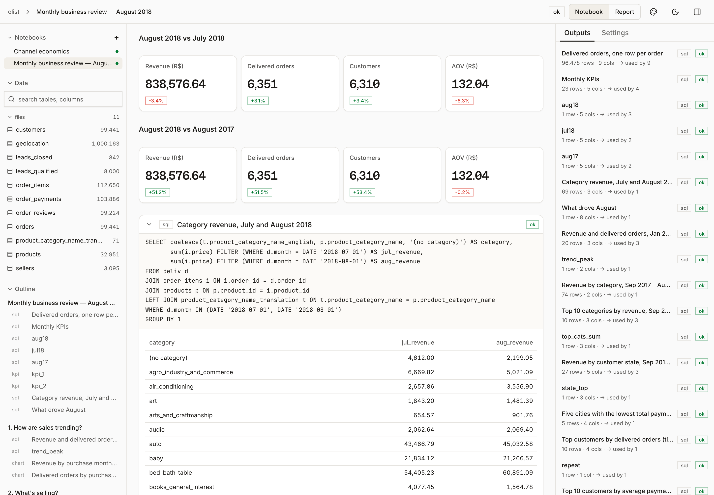
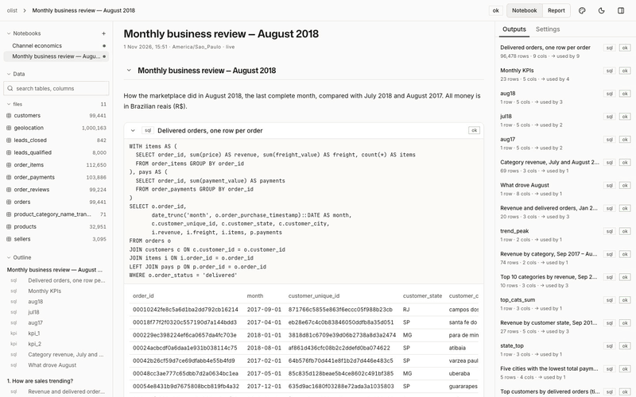

# tracebook

Agent-native data notebook. You ask your coding agent a question about your data files (CSV, Excel, JSON, SQLite, Parquet). It answers inside a notebook of SQL / Python / `.xlsx`-model blocks run on DuckDB. Every number in the answer traces back to the block that computed it, and you can check it, comment on it, and rerun it on new data.


*Notebook view of `examples/olist/` in the Enterprise theme (light): the August 2018 monthly business review Claude Code built from the Olist marketplace data. Every R$ figure links to the block that computed it.*



Full-resolution video: [docs/tracebook_demo.mp4](docs/tracebook_demo.mp4). Report view of the same notebook.

## Install
```bash
npm i -g tracebook-cli       # or without installing: npx tracebook-cli <command>
tracebook setup              # adds the skill to Claude Code, Codex, pi, OpenCode (whichever are installed)
```
First run installs [uv](https://docs.astral.sh/uv/) if missing (it provides Python). From a checkout: `uv tool install .`. Release: bump `version` in `pyproject.toml` and `npm/package.json`, push a `vX.Y.Z` tag; CI publishes to npm.

## User flow
1. **Start.** `tracebook init analysis`, drop your files in `data/`, `tracebook import data/*`. Import is typed: an ambiguous date or mixed column stops with the fix to apply instead of loading wrong values.
2. **Ask** your agent, e.g. "where do customers drop off in checkout?". It explores the data, writes the notebook (SQL / Python / sheet blocks, KPIs, charts, sentences whose numbers are references like `{{funnel.paid}}`) and runs `tracebook check` until it passes.
3. **Review.** `tracebook dev` opens the viewer: click any number to see the query and rows behind it, switch Notebook / Report view and Terminal / Enterprise theme, leave a comment where something looks wrong.
4. **Fix.** On its next turn the agent reads `tracebook comments`, changes the notebook and resolves each comment with a note.
5. **Share and rerun.** `tracebook export` writes a self-contained HTML report (`--block <id> out.csv` for one result). On new data: import, `tracebook check`, and `tracebook diff` lists what changed.

The agent runs these commands itself; its workflow is in `src/tracebook/skill/SKILL.md`.

## Evaluation
Two layers, measured on the same tasks (Claude Haiku 4.5; score = share of questions correct):
- **Data-agent layer:** does the agent get the right answer? **CC** = plain Claude Code, **CC+P** = plus a generic data-analysis playbook skill.
- **Notebook layer:** **CC+P+T** = plus Tracebook; it should stay as correct and leave a checked notebook behind.

### Web-log funnel (Spider2-lite)
Funnel questions on a website-log SQLite db: `local329` (one count) and `log-web-funnel` (four questions in one request). 3 attempts per setup.

| Setup | `local329` | `log-web-funnel` | Notebook built | Cost |
|---|---|---|---|---|
| **CC** | 3/3 | 33 % | — | $0.51 |
| **CC+P** | 2/3 | 17 % | — | $0.67 |
| **CC+P+T** | 3/3 | 17 % | 6/6 | $0.76 |

### Olist marketplace
A monthly business review (4 Spider2-lite questions + 3 of ours) and seller-channel economics (7 of ours) on the Olist orders db. 2 attempts per setup.

| Setup | Monthly review | Channel economics | Notebook built | Cost |
|---|---|---|---|---|
| **CC** | 43 % | 64 % | — | $0.61 |
| **CC+P** | 64 % | 50 % | — | $0.63 |
| **CC+P+T** | 64 % | 64 % | 2/4 | $1.15 |

## Repository layout
| Path | What |
|---|---|
| `src/tracebook/` | CLI, runtime (import, blocks, `check`), source packs (e.g. Razorpay), agent skill, built viewer |
| `playbooks/` | Claude Code skills with data-analysis know-how, independent of Tracebook (`data-analysis`) |
| `web/` | viewer source (React + Vite); `npm run build` writes `src/tracebook/viewer/` |
| `tests/` | `uv run pytest` |
| `evals/` | Harbor adapter for Spider2-lite, setup configs, runner |
| `examples/razorpay-demo/` | example workspace (`tracebook import data/*.xlsx && tracebook check` rebuilds it) |
| `examples/online-retail/` | customer-insights notebook made by Claude Code from [UCI Online Retail II](https://archive.ics.uci.edu/dataset/502/online+retail+ii) (CC BY 4.0; put `online_retail_II.xlsx` in `data/`, then `tracebook init . --tz Europe/London && tracebook import data/* && tracebook check`) |
| `examples/olist/` | monthly business review + seller-channel economics notebooks made by Claude Code from the Olist marketplace data (CC BY-NC-SA 4.0; Spider2's `E_commerce.sqlite`, see `evals/adapters/spider2-lite/fetch.sh`, as `data/olist.sqlite`, then `tracebook init . --tz America/Sao_Paulo && tracebook import data/olist.sqlite && tracebook check`) |
| `docs/` | screenshots, demo video |
